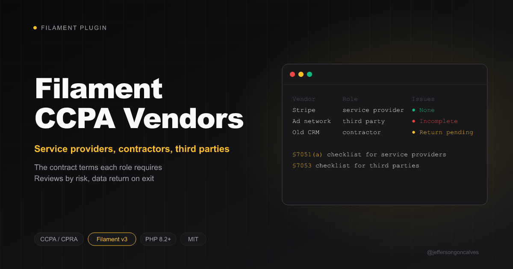

<div class="filament-hidden">



</div>

# Filament CCPA Vendors

[](https://packagist.org/packages/jeffersongoncalves/filament-ccpa-vendors)
[](https://github.com/jeffersongoncalves/filament-ccpa-vendors/actions?query=workflow%3Atests+branch%3A3.x)
[](https://github.com/jeffersongoncalves/filament-ccpa-vendors/actions?query=workflow%3A"Fix+PHP+code+styling"+branch%3A3.x)
[](https://packagist.org/packages/jeffersongoncalves/filament-ccpa-vendors)
[](LICENSE.md)

Keep the register of vendors you share personal data with, from [laravel-ccpa-vendors](https://github.com/jeffersongoncalves/laravel-ccpa-vendors), in your Filament panel. Each vendor shows what it still owes under the CCPA.

## Features

- Vendors with role (service provider, contractor or third party), risk tier, services, business purpose and personal information disclosed.
- Written contract: signed and expiry dates, plus a checklist of the terms the role requires (Regulations §7051(a) for service providers and contractors, §7053 for third parties). The checklist changes with the role and comes from the `ccpa-vendors.checklist` config.
- An **Issues** column: missing, expired or incomplete agreement, no transfer mechanism, review due, data return pending.
- Actions: **Mark as reviewed**, **End relationship** and **Data deleted or returned**.
- 19 languages.

## Compatibility

| Plugin Version                                                              | Filament |
|-----------------------------------------------------------------------------|----------|
| [1.x](https://github.com/jeffersongoncalves/filament-ccpa-vendors/tree/1.x) | 3.x      |
| [2.x](https://github.com/jeffersongoncalves/filament-ccpa-vendors/tree/2.x) | 4.x      |
| [3.x](https://github.com/jeffersongoncalves/filament-ccpa-vendors/tree/3.x) | 5.x      |

## Installation

You can install the package via composer:

```bash
composer require jeffersongoncalves/filament-ccpa-vendors:"^3.0"
php artisan vendor:publish --tag="ccpa-vendors-migrations"
php artisan migrate
```

## Usage

```php
use JeffersonGoncalves\Filament\CcpaVendors\CcpaVendorsPlugin;

public function panel(Panel $panel): Panel
{
    return $panel
        ->plugins([
            CcpaVendorsPlugin::make()
                ->navigationGroup('CCPA')             // default: no group
                ->navigationSort(6)
                ->navigationIcon('heroicon-o-building-office-2')
                ->slug('vendors'),
        ]);
}
```

All fluent methods are optional.

> The resource has no authorization of its own: register it only on panels whose users maintain the register, or add a policy for `JeffersonGoncalves\CcpaVendors\Models\Vendor`.

## Testing

```bash
composer test
```

## Changelog

Please see [CHANGELOG](CHANGELOG.md) for more information on what has changed recently.

## Contributing

Please see [CONTRIBUTING](.github/CONTRIBUTING.md) for details.

## Security Vulnerabilities

Please review [our security policy](../../security/policy) on how to report security vulnerabilities.

## Credits

- [Jefferson Gonçalves](https://github.com/jeffersongoncalves)
- [All Contributors](../../contributors)

## License

The MIT License (MIT). Please see [License File](LICENSE.md) for more information.
